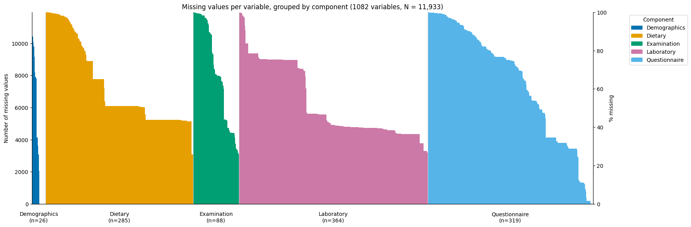
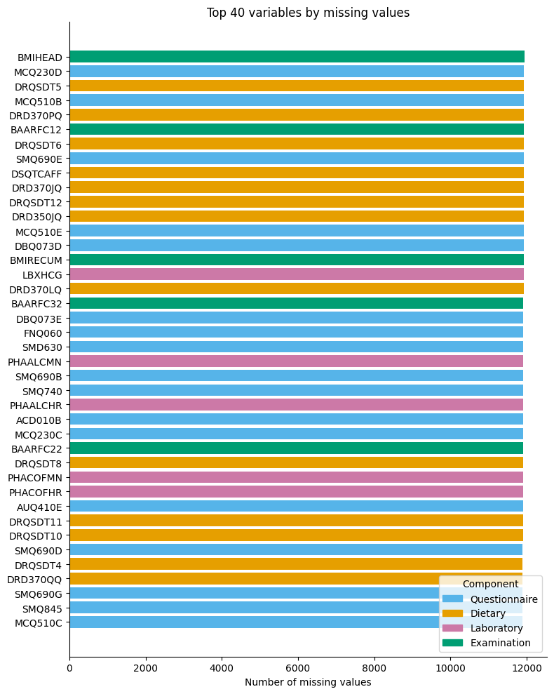

This includes files for exploration of the [National Health and Nutrition Examination Survey](https://wwwn.cdc.gov/nchs/nhanes/continuousnhanes/default.aspx?Cycle=2021-2023) data collected from August 2021-2023. 
#### Report
Number of individuals for which data has been collected for = 11933 
Data has been collected across five different components of data mainly - Laboratory' 'Examination' 'Questionnaire' 'Demographics' 'Dietary'  
Data has been collected for 91 different values, each representing data from different components. These are the files DEMO_L.xpt, AGP_L.xpt etc. For details of what each data file name indicates, and what variables they contain look into the `nhanes_variable_list.csv` 
The mean, median, number of missing values, standard deviation, max and min values of all the variables is stored in the `nhanes_summary.csv` data file  
The distribution of missing values across different components is  

Top 40 features with missing values is  
 
